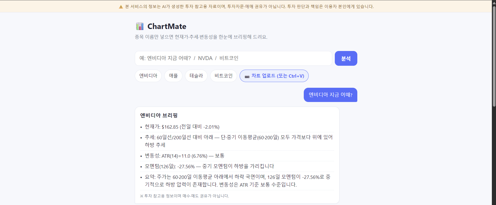
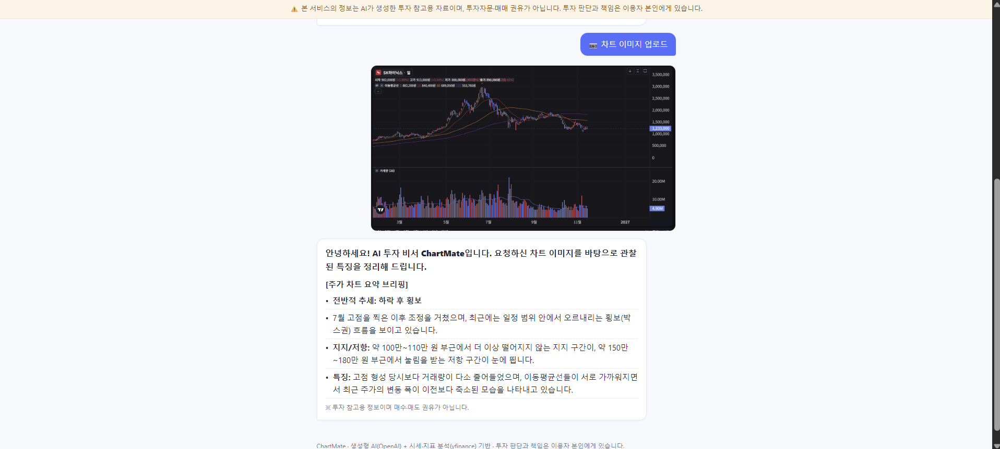
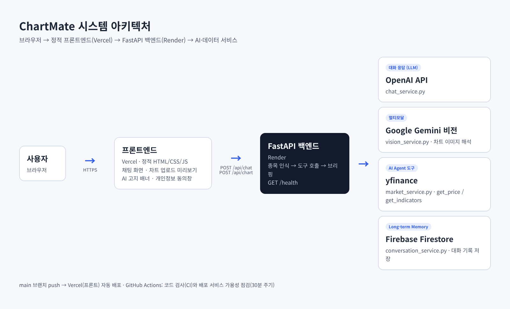
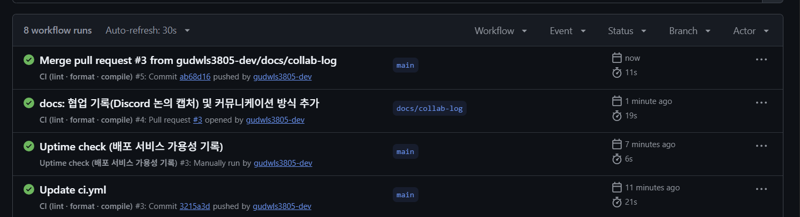

# ChartMate

> 차트 해석과 지표 조회를 대화 한 번으로 대신 해주는, 투자 초보용 AI 투자 비서.

## 링크

| 구분 | 주소 |
|------|------|
| **배포 서비스 (프론트엔드)** | https://chartmate-frontend.vercel.app/ |
| 백엔드 API | https://chartmate.onrender.com |
| 백엔드 상태 확인 | https://chartmate.onrender.com/health |
| API 문서 | https://chartmate.onrender.com/docs |
| 발표 자료 | [docs/presentation.pdf](docs/presentation.pdf) |
| 배포·운영 증빙 | [docs/deploy-evidence.md](docs/deploy-evidence.md) |
| 협업 기록 | [docs/collaboration-log.md](docs/collaboration-log.md) |
| 기획서 / 기능요구명세서 | [docs/기획서.md](docs/기획서.md) / [docs/기능요구명세서.md](docs/기능요구명세서.md) |

> 백엔드는 무료 인스턴스입니다. 서버가 잠들지 않도록 5분마다 점검 요청을 보내고, 페이지를 열 때도 서버를 미리 깨웁니다. 자세한 내용은 [응답 속도](#응답-속도)를 참고하세요.

## 프로젝트 소개

투자 초보가 겪는 ① 차트를 봐도 해석하기 어렵고, ② 종목마다 지표를 매번 찾아보기 번거로운 문제를 대화형으로 해소하는 AI 투자 비서입니다.

- 종목을 물으면 비서가 **시세·지표를 직접 조회**해 초보 눈높이로 브리핑합니다. (AI Agent)
- 차트 이미지를 올리면 **추세와 주요 구간을 읽어** 말로 설명합니다. (멀티모달)
- 대화 기록을 사용자별로 저장하고, 다시 방문하면 지난 대화를 불러와 이어서 답합니다. (Long-term Memory)

자세한 문제 정의와 설계 근거는 [기획서](docs/기획서.md)를 참고하세요.

## 서비스 동작 화면

배포 주소에서 2026-11-14에 캡처한 화면입니다. 전체 증빙은 [배포·운영 증빙](docs/deploy-evidence.md)에 있습니다.

| 종목 질문 → 지표 브리핑 | 차트 이미지 → 해석 |
|---|---|
|  |  |

## 팀원 및 역할

| 이름 | GitHub | 역할 | 담당 업무 |
|------|--------|------|-----------|
| 전민재 | [@QWERQWER-qwer](https://github.com/QWERQWER-qwer) | PM / Backend | 기획서·기능요구명세서, AI Agent·멀티모달 백엔드 구현, 배포 |
| 김경민 | [@gudwls3805-dev](https://github.com/gudwls3805-dev) | Frontend | 차트 업로드 미리보기, AI 고지 배너, 개인정보 동의창, 피드백 반영 UI, 발표자료, README·배포 증빙 정리 |
| 윤태성 | [@yts-cmd](https://github.com/yts-cmd) | Test / Docs | 구글폼 제작, 실사용자 테스트 운영, 응답 정리·피드백 요약, AI 윤리·개인정보 문구 |

## 기술 스택

| 구분 | 선택 | 선정 이유 |
|------|------|-----------|
| 대화 (LLM) | OpenAI API | 선행 프로젝트에서 검증한 대화 비서 기반을 재사용 |
| 멀티모달 | Google Gemini 비전 | 이미 검증된 차트 이미지 분석 코드를 이식. 지정 OpenAI 엔드포인트가 이미지 입력을 지원하지 않음 |
| 시세·지표 | yfinance | Agent 도구의 현재가·이동평균·모멘텀·ATR 조회용 |
| Backend | FastAPI (Render) | 자동 문서화(`/docs`)가 도구 호출 테스트에 유리 |
| Frontend | HTML / CSS / JavaScript (Vercel) | 프레임워크 학습 비용 없이 빠르게 구현·배포 |
| DB | Firebase Firestore | 대화 기록 저장 |
| CI | GitHub Actions | 코드 스타일 검사, 배포 서비스 가용성 점검 |

선정 근거의 상세 내용은 [기획서 4장](docs/기획서.md)에 있습니다.

## 시스템 아키텍처



## 핵심 AI 활용

| 기술 요소 | 구현 내용 | 코드 |
|-----------|-----------|------|
| **AI Agent** | 질문에서 종목을 인식(사전 → 모델 추론)하고 `get_price`·`get_indicators` 도구를 호출해, 조회 결과를 근거로 브리핑을 생성 | [chat_service.py](backend/app/services/chat_service.py), [market_service.py](backend/app/services/market_service.py) |
| **멀티모달** | 차트 이미지를 Gemini 비전으로 읽어 추세·지지/저항·특징을 설명 | [vision_service.py](backend/app/services/vision_service.py), [routers/chart.py](backend/app/routers/chart.py) |
| **Long-term Memory** | 동의한 브라우저에 익명 사용자 ID를 만들고, 대화를 그 ID와 함께 Firestore에 저장. 재방문 시 마지막 대화를 자동으로 불러와 맥락을 이어감 | [conversation_service.py](backend/app/services/conversation_service.py), [routers/conversations.py](backend/app/routers/conversations.py), [frontend/index.html](frontend/index.html) |

지정된 OpenAI 엔드포인트가 function calling을 지원하지 않아, Agent는 "종목 인식 → 도구 실행 → 결과 주입" 순서의 라우터 방식으로 구현했습니다. 프롬프트는 현황 설명과 지표 해석으로 한정하고, 매수·매도 권유를 하지 않도록 했습니다.

## 요구사항별 구현 위치

| ID | 기능 | 상태 | 엔드포인트 | 구현 파일 |
|----|------|------|-----------|-----------|
| FR-01 | 대화형 질의응답 | 구현 | `POST /api/chat` | [routers/chat.py](backend/app/routers/chat.py), [chat_service.py](backend/app/services/chat_service.py) |
| FR-02 | 시세·지표 조회 (Agent) | 구현 | `POST /api/chat` 내부 도구 호출 | [market_service.py](backend/app/services/market_service.py) |
| FR-03 | 차트 이미지 해석 (멀티모달) | 구현 | `POST /api/chart` | [routers/chart.py](backend/app/routers/chart.py), [vision_service.py](backend/app/services/vision_service.py) |
| FR-04 | 대화기록 저장·맥락 유지 | 구현 | `POST /api/chat`, `GET /api/conversations/latest?user_id=` | [conversation_service.py](backend/app/services/conversation_service.py), [routers/conversations.py](backend/app/routers/conversations.py) |
| FR-05 | 관심종목 관리 (Should) | 미구현 | - | - |
| FR-06 | AI 고지·투자 유의 표시 | 구현 | - | [frontend/index.html](frontend/index.html) 상단 고정 배너 |
| FR-07 | 개인정보 수집 동의 | 구현 | - | [frontend/index.html](frontend/index.html) 첫 방문 동의창 |
| FR-08 | 사용자 피드백 수집 (Could) | 구현 | 구글폼 | [docs/user-test/](docs/user-test/) |

- FR-04: 개인정보 수집에 동의하면 브라우저에 익명 사용자 ID가 만들어지고, 대화가 이 ID와 함께 저장됩니다. 다시 방문하면 마지막 대화를 자동으로 불러오며, "새 대화 시작"으로 비울 수 있습니다. 로그인이 없으므로 다른 기기·브라우저와는 이어지지 않습니다.
- 동작 증거(화면 캡처, `/health` 응답)는 [배포·운영 증빙](docs/deploy-evidence.md)에 있습니다.

## 실행 방법

### 요구사항
- Python 3.12
- 프론트엔드는 정적 파일이라 별도 빌드가 필요 없습니다.

### 설치 및 실행
```bash
git clone https://github.com/gudwls3805-dev/chartmate.git
cd chartmate

# Backend
cd backend
pip install -r requirements.txt
uvicorn app.main:app --reload   # http://localhost:8000/docs

# Frontend
# frontend/index.html을 브라우저로 열면 로컬 백엔드(localhost:8000)에 연결됩니다.
# 배포본은 https://chartmate-frontend.vercel.app/ 에서 바로 쓸 수 있습니다.
```

### 환경 변수 (`backend/.env`)
```
OPENAI_API_KEY=...
OPENAI_BASE_URL=...            # 선택
GEMINI_API_KEY=...
FIREBASE_KEY_PATH=serviceAccountKey.json   # 로컬: Firebase 서비스 계정 키 파일 경로
# 배포 환경에서는 FIREBASE_SERVICE_ACCOUNT_JSON 에 키 JSON 문자열을 넣습니다.
```

Firebase 키가 없으면 서버가 시작되지 않습니다. 키 파일과 `.env`는 저장소에 올리지 않습니다.

## 응답 속도

목표(NFR-01)는 일반 질의 5초 이내입니다. 무료 인스턴스가 잠들면 첫 요청이 느려지는 문제를 다음과 같이 줄였습니다.

| 조치 | 내용 | 위치 |
|------|------|------|
| 서버 상시 유지 | 5분마다 `/health`에 점검 요청을 보내 서버가 잠들지 않게 함 | [healthcheck.yml](.github/workflows/healthcheck.yml) |
| 미리 깨우기 | 페이지를 여는 즉시 `/health`를 호출해, 사용자가 화면을 읽는 동안 서버를 준비시킴 | [frontend/index.html](frontend/index.html) |
| 이미지 축소 | 차트 이미지를 전송 전에 최대 1280px로 줄여 전송·분석 시간을 줄임 | [frontend/index.html](frontend/index.html) |
| 응답 시간 표시 | 답변마다 실제 걸린 시간을 화면에 표시해 지연을 바로 확인 | [frontend/index.html](frontend/index.html) |

차트 이미지 해석은 비전 모델 호출이 포함되어 일반 질의보다 오래 걸립니다.

## 사용자 테스트 결과

- **테스터**: 5명 (주식 투자 경험자 및 관심 사용자), 2026-11-08, 구글폼 3문항
- **차트 해석·지표 설명 유용도**: 평균 **4.8 / 5** (5점 4명, 4점 1명)
- **재사용 의향**: 5명 모두 다시 쓸 의향이 있다고 응답
- 원자료: [응답정리.md](docs/user-test/응답정리.md) · 분석: [피드백요약.md](docs/user-test/피드백요약.md)

| 받은 피드백 | 조치 | 상태 |
|-------------|------|------|
| 이미지 분석 대기가 길게 느껴진다 | 로딩 스피너 추가, 서버 미리 깨우기·상시 유지, 응답 시간 표시 | 반영 |
| 모바일에서 차트 업로드 버튼이 잘 안 보인다 | 버튼 강조색, 모바일에서 전체 폭 | 반영 |
| 모바일에서 글이 많아 읽기 피로하다 | 3줄 요약 카드 우선 노출 | 예정 |
| 미국 종목·해외 ETF 차트 지원 | 데이터 연동 검토 | 중장기 |
| 분할 매수·손절 기준 안내 | 매매 권유 금지 원칙과 맞는지 검토 | 검토 |

반영 항목은 테스트 이후 프론트엔드에 적용했으며, 재테스트는 아직 하지 않았습니다.

## 협업 과정

### 역할 수행
역할은 [팀원 작업 가이드](docs/팀원가이드.md)로 나누었고, 각자 맡은 작업을 본인 GitHub 계정으로 커밋했습니다.

### 커뮤니케이션
- Discord 채널에서 비동기로 소통했습니다.
- 11월 3일: 제출물 기준으로 전체 할 일을 단계별로 나누고 담당을 정했습니다.
- 11월 4일: 프론트엔드와 사용자 테스트·문서 담당에게 작업 내용과 완료 기준을 전달했습니다.
- 11월 8일: 사용자 테스트 결과를 공유하고, 개선 과제를 프론트엔드에 반영하기로 했습니다.
- 대화 캡처와 날짜별 정리는 [협업 기록](docs/collaboration-log.md)에 있습니다.

### 브랜치 전략
- `main`: 배포 브랜치. push되면 프론트엔드가 자동 배포됩니다.
- 작업은 `feature/*`, `docs/*`, `chore/*` 브랜치에서 하고 Pull Request로 `main`에 병합합니다.
- 초기 개발(11월 4일~14일 오전)은 `main`에 직접 커밋했고, 2026-11-14부터 브랜치와 PR 방식으로 바꿨습니다.
- PR 목록: https://github.com/gudwls3805-dev/chartmate/pulls?q=is%3Apr

### 기여 기록
| 팀원 | GitHub | 커밋 수 (2026-11-16 기준, 병합 커밋 제외) | 주요 커밋 |
|------|--------|-------------------------------|-----------|
| 전민재 | QWERQWER-qwer | 6 | 초기 구조·문서, AI Agent, 멀티모달 차트 분석, 배포 설정 |
| 윤태성 | yts-cmd | 7 | AI 윤리 문구, 구글폼 링크, 테스트 응답 정리, 피드백 요약 |
| 김경민 | gudwls3805-dev | 10 이상 | 프론트엔드 UI(배너·동의창·업로드 미리보기), 대화 복원·응답 속도 개선, README·증빙 문서, CI·가용성 점검, 발표자료 (PR #1~#4) |

- 전체 커밋 기록: https://github.com/gudwls3805-dev/chartmate/commits/main
- 기여자 그래프: https://github.com/gudwls3805-dev/chartmate/graphs/contributors

## 코드 스타일

- 백엔드는 **black**(포맷)과 **ruff**(린트, import 정렬)를 사용합니다. 설정은 [backend/pyproject.toml](backend/pyproject.toml)에 있습니다.
- [CI 워크플로](.github/workflows/ci.yml)가 `main` push와 모든 PR에서 `ruff check`, `black --check`, 문법 검사를 실행합니다.
- 실행 결과: https://github.com/gudwls3805-dev/chartmate/actions/workflows/ci.yml



```bash
cd backend
pip install ruff black
ruff check . && black --check .
```

## AI 윤리·개인정보

- 모든 화면 상단에 "AI가 생성한 투자 참고용 자료이며 투자자문·매매 권유가 아님"을 고지합니다.
- 첫 방문 시 대화 내용 저장에 대한 동의를 받습니다. 동의하지 않으면 대화 기능을 사용할 수 없고, 차트 이미지 분석만 이용할 수 있습니다.
- 사용자 구분에는 이름·이메일 대신 브라우저에서 무작위로 만든 익명 ID만 사용합니다. 동의한 경우에만 만들고, 동의를 철회하면 브라우저에서 지웁니다.
- 민감정보는 수집하지 않습니다. 전문은 [ai-ethics-notice.md](docs/ai-ethics-notice.md)에 있습니다.

## 한계

- 비공식 시세 API(yfinance)를 사용해 실시간성과 정확성이 보장되지 않습니다.
- 차트 해석은 비전 모델의 '관찰'이며 미래 예측이 아닙니다. 차트가 아닌 이미지도 해석할 수 있습니다.
- 텍스트 지표는 일봉 기준(이동평균 60·200일, 모멘텀 126일, ATR)만 제공합니다.
- 관심종목 관리는 구현하지 않았습니다. 대화 복원은 로그인 없이 브라우저별 익명 ID로 하므로, 다른 기기나 브라우저에서는 이어지지 않습니다.
- 본 서비스는 투자 참고용이며 투자자문·매매 권유가 아닙니다.

상세한 한계와 구현·미구현 구분은 [기획서 7장](docs/기획서.md)에 있습니다.
