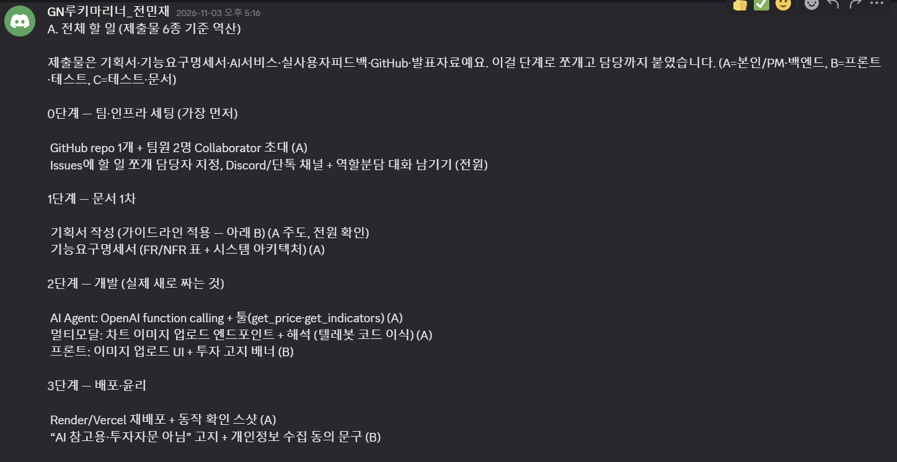
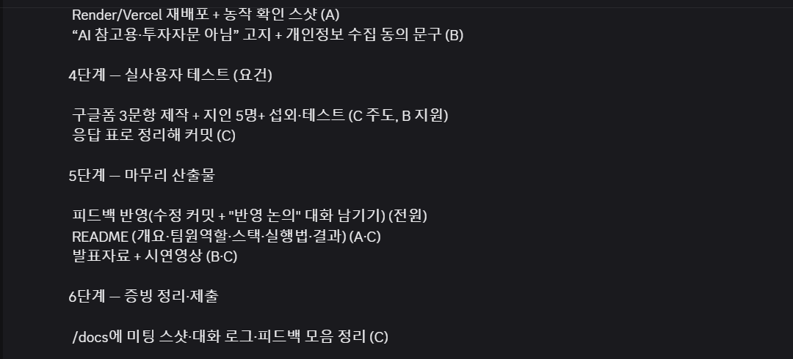
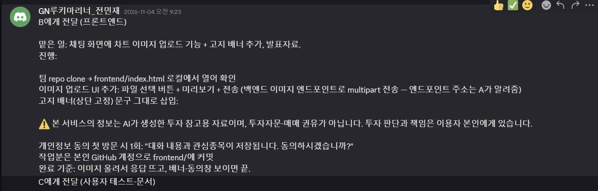
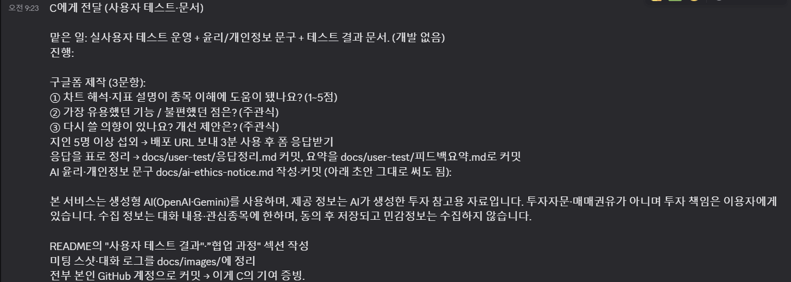
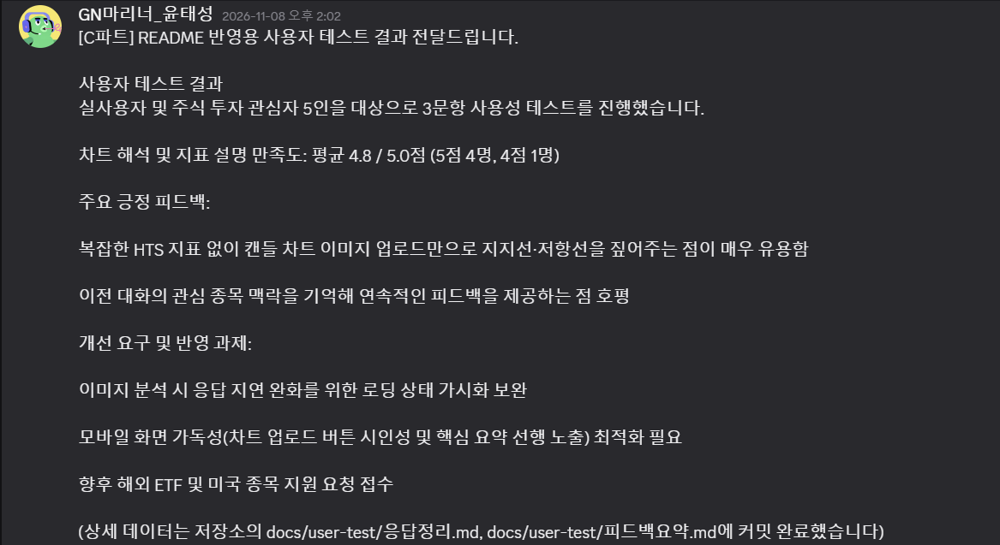

# 협업 기록

팀은 Discord 채널에서 비동기로 소통했습니다. 아래는 주요 논의를 날짜순으로 정리한 것이고, 캡처는 원본 대화 화면입니다.

## 타임라인

| 날짜 | 내용 | 작성자 |
|------|------|--------|
| 2026-11-03 | 제출물 6종 기준으로 전체 할 일을 0~6단계로 나누고 단계별 담당을 정함 | 전민재 |
| 2026-11-04 | 프론트엔드(김경민), 사용자 테스트·문서(윤태성) 작업 내용과 완료 기준 전달 | 전민재 |
| 2026-11-04 | 초기 구조, AI Agent, 멀티모달 차트 분석 구현 및 배포 | 전민재 |
| 2026-11-08 | 구글폼 사용자 테스트(5명) 결과와 README 반영용 요약 공유, 문서 커밋 | 윤태성 |
| 2026-11-14 | 프론트엔드 UI(고지 배너·동의창·업로드 미리보기), 피드백 2건 반영, 발표자료 | 김경민 |
| 2026-11-16 | 평가 피드백 반영: README·배포 증빙(PR #1), 코드 스타일 적용(PR #2), CI·가용성 점검 추가 | 김경민 |

## 1. 전체 계획과 단계별 담당 (2026-11-03)

## 2. 작업 전달 (2026-11-04)

프론트엔드 담당에게 전달한 작업 내용과 완료 기준입니다.

사용자 테스트·문서 담당에게 전달한 작업 내용입니다.

## 3. 사용자 테스트 결과 공유 (2026-11-08)

테스트 담당이 결과 요약과 개선 과제를 공유했고, 이 내용이 README의 "사용자 테스트 결과"와 프론트엔드 개선(로딩 표시, 업로드 버튼 시인성)에 반영됐습니다.

## 4. 코드 협업 기록

- Pull Request: https://github.com/gudwls3805-dev/chartmate/pulls?q=is%3Apr
- 커밋 기록: https://github.com/gudwls3805-dev/chartmate/commits/main
- 기여자 그래프: https://github.com/gudwls3805-dev/chartmate/graphs/contributors
