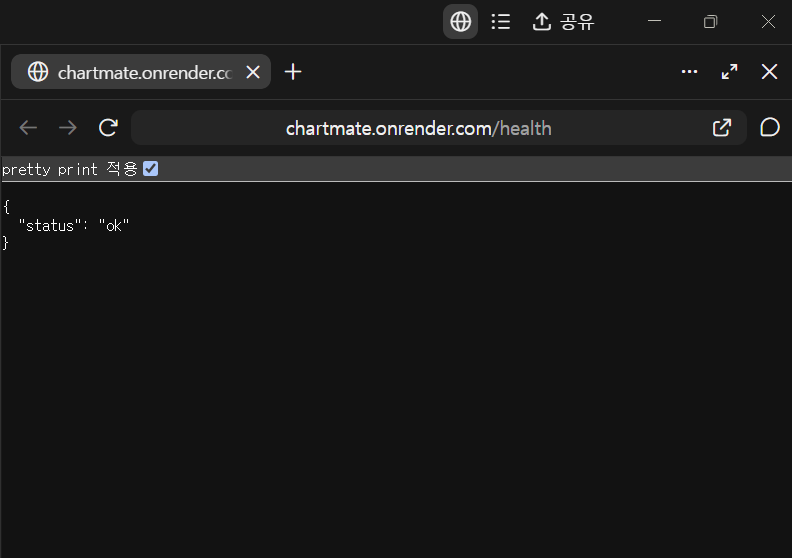
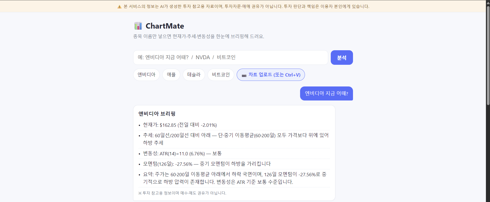
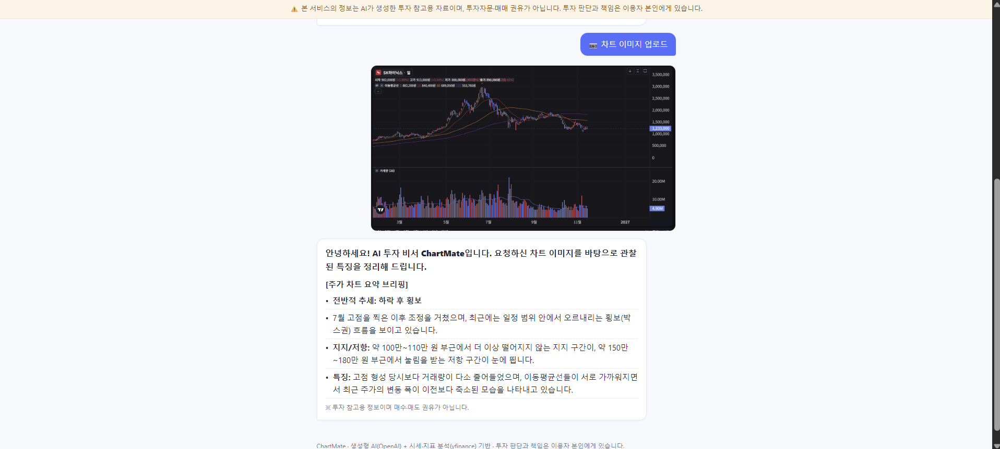
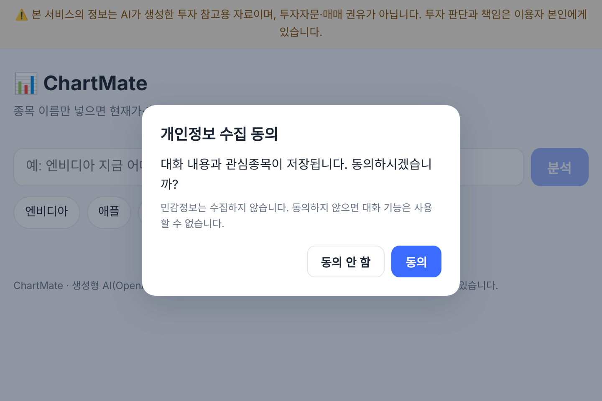
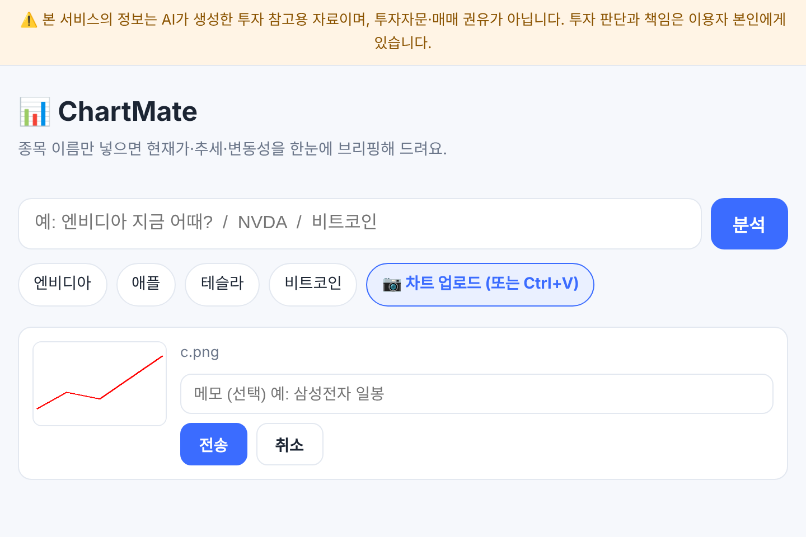

# 배포·운영 증빙

ChartMate가 외부에서 접근 가능한 형태로 배포되어 동작하고 있음을 보여 주는 자료입니다.

## 1. 배포 주소

| 구분 | 주소 | 호스팅 |
|------|------|--------|
| 프론트엔드 (서비스 화면) | https://chartmate-frontend.vercel.app/ | Vercel |
| 백엔드 API | https://chartmate.onrender.com | Render |
| 백엔드 상태 확인 | https://chartmate.onrender.com/health | Render |
| API 문서 (FastAPI 자동 생성) | https://chartmate.onrender.com/docs | Render |

> Render 무료 인스턴스는 일정 시간 요청이 없으면 잠들어, 첫 요청에 30초~1분이 걸릴 수 있습니다.

## 2. 실행 확인 (2026-11-14 캡처)

### 2-1. 백엔드 `/health` 응답

브라우저에서 `https://chartmate.onrender.com/health`를 열어 `{"status": "ok"}` 응답을 확인했습니다.



직접 확인하는 방법:

```bash
curl https://chartmate.onrender.com/health
# {"status":"ok"}
```

### 2-2. 종목 질문 → 지표 브리핑 (AI Agent, `POST /api/chat`)

배포된 프론트엔드에서 "엔비디아 지금 어때?"를 입력해 현재가·추세·변동성·모멘텀 브리핑을 받은 화면입니다.
백엔드가 `market_service.get_price` / `get_indicators`로 시세와 지표를 조회한 뒤 응답을 생성합니다.



### 2-3. 차트 이미지 업로드 → 해석 (멀티모달, `POST /api/chart`)

배포된 프론트엔드에서 차트 이미지를 올려 추세와 지지·저항 구간 설명을 받은 화면입니다.
백엔드 `vision_service.analyze_chart`가 Gemini 비전으로 이미지를 해석합니다.



### 2-4. AI 고지 배너 · 개인정보 동의

| 첫 방문 동의창 | 차트 업로드 미리보기 |
|---|---|
|  |  |

두 화면은 개발 중 로컬에서 캡처한 것이며, 같은 코드가 배포되어 있습니다. 고지 배너는 위 2-2, 2-3 캡처의 화면 상단에서 확인할 수 있습니다.

## 3. 운영 가용성 기록

- **주기 점검**: [`.github/workflows/healthcheck.yml`](../.github/workflows/healthcheck.yml)이 30분마다 백엔드 `/health`와 프론트엔드 주소에 요청을 보내고, 응답 코드와 응답 시간을 실행 기록에 남깁니다.
- **기록 위치**: GitHub 저장소의 **Actions → Uptime check** 탭에서 실행별 성공·실패와 로그를 볼 수 있습니다.
  https://github.com/gudwls3805-dev/chartmate/actions/workflows/healthcheck.yml
- 점검은 2026-11-14에 추가했으며, 그 이전 기간의 가용성 기록은 없습니다.

## 4. 배포 방식

- 프론트엔드: `main` 브랜치에 push하면 Vercel이 자동으로 다시 배포합니다. (2026-11-14 `frontend/index.html` 커밋 후 수 분 내 배포 주소에 반영된 것을 확인)
- 백엔드: Render에 배포되어 있으며, 환경변수(`OPENAI_API_KEY`, `GEMINI_API_KEY`, `FIREBASE_SERVICE_ACCOUNT_JSON` 등)는 Render 대시보드에서 관리합니다. 비밀값은 저장소에 올리지 않습니다.
